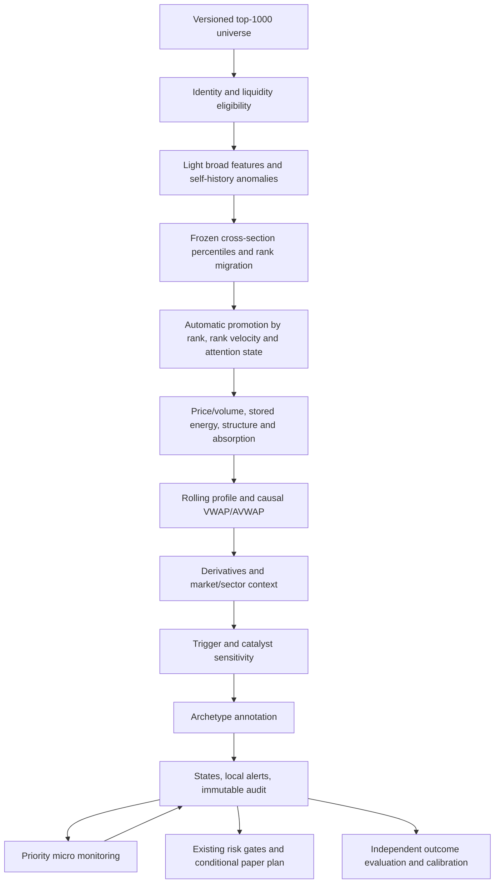

# Pre-Expansion Discovery Engine v2 — proposed architecture

**Status: design for review, not an implemented upgrade.** Inspection date: 2026-10-04 UTC.
The current production modules remain unchanged. These changes are incremental additions, subject to
the evidence and release gates in [GAP_ANALYSIS.md](GAP_ANALYSIS.md) and
[REGRESSION_TEST_PLAN.md](REGRESSION_TEST_PLAN.md). Feature formulas are specified in
[FEATURE_DEFINITIONS.md](FEATURE_DEFINITIONS.md); scores below are research rules, not probabilities.
No SAND/BEAM detection claim follows from this design. Exact event definitions, verified asset identities,
historical universes, point-in-time observations and original decision logs are needed to establish it.
The local evidence audit found only a smoke archive with two runs (one failed, one completed on
2026-10-03), BTC/ETH observations and an empty study template. It found no SAND/BEAM event
manifest or pre-event scan/alert archive. Later-retrieved candle history cannot establish earlier
availability. This prevents an observed miss attribution or proven pre-move lead time today.

## 1. What exists and should be retained

| Current component | Inspected behavior | Preservation and addition |
|---|---|---|
| `models.py` | Strict Pydantic contracts; timezone-aware event/availability times; closed-bar invariants; finite values | Retain v1 readers and validators; add v2 contracts rather than reinterpret old fields |
| `config.py`, `providers/coingecko.py` | Both validate a maximum 500-asset market-cap universe | Introduce versioned discovery settings and tested 1,000-cap pagination; do not merely remove one limit |
| `providers/base.py` | Separate market, spot and derivatives async protocols; explicit missing metrics | Extend optional bulk, incremental, trades/book and streaming capabilities through new protocols |
| `providers/http.py`, `runtime.py` | GET-only bounded retries; CA/proxy trust; per-host weight limits; shared lifecycle | Preserve security, cancellation and rate limiting; add scheduler-wide request budgets |
| `providers/binance.py` | Verified IDs/pairs, native candles/quote/taker volume, bounded books, actual funding cadence, matched spot/futures windows | Preserve identity and unit safeguards; add additional venues without alias guessing |
| `technical.py`, `avwap.py` | Causal technical snapshots, confirmed swings/ranges, fixed breakout episodes, six anchor families, acceptance-based reclaims | Reuse mathematics and provenance; add continuous pressure/absorption, rolling profiles and failed-breakout anchors |
| `regime.py`, `risk.py` | Causal BTC/ETH context, breadth, leverage risk, stale-data and portfolio gates, conditional long paper plans | Keep these gates downstream; discovery attention never authorizes an order or bypasses risk |
| `scanner.py` | Bounded-memory fan-out over the whole mapped universe; stage collected candle histories on disk; compute technical features; optional confirmed-candidate refresh | Keep a compatibility full scan; add broad/deep/micro workers that share validated inputs |
| `storage.py` | SQLite WAL, compressed immutable snapshots, run status, globals, completed-run publication | Preserve existing tables and published reports; add audit/rank/event tables with migrations |
| `replay.py`, `research.py` | Availability-filtered replay; contemporaneous matched controls, failure outcomes, later validation | Reuse causal filtering and control logic; extend to microtime panels and discovery outcomes |
| `cli.py`, `api.py` | Scan/watch/inspect/evaluate/replay/research; local read-only API and optional report token | Keep existing commands/endpoints; expose v2 read-only discovery and evaluation separately |

Current flow: cap-ranked universe → policy exclusions → pair resolution → all configured histories and
market/liquidity/derivatives per mapped asset → BTC/ETH and breadth → technical analysis → fixed
archetype-weight evidence → `expansion_score`/confidence sort → optional entry refresh → stored report.
Defaults are 500 assets, seven timeframes, 400 bars, concurrency six. Stage selection requires usable
4h and daily histories and uses 4h patterns; 1m/5m/15m observations cannot independently change stage.
Multiweek-range detection means short microtime histories cannot supply a multiweek base merely
because those frames were downloaded. `watch` sleeps 300 seconds **after** the full scan finishes.
API asset views read the latest completed full batch. No persisted dynamic promotion, cross-sectional
rank trajectory, alert episode or daily mover evaluation exists. Batch errors identify skipped assets,
but those assets do not receive feature/state observation rows.

## 2. Target processing order

Discovery ranking uses generic evidence before archetype annotation. Legacy QNT/ZEC/TAO/ONDO
scores remain visible as named descriptive fields; they do not gate universe membership, promotion
or v2 pre-move alerts. No special SAND, BEAM or sector exception enters production logic.
`EXPANSION_SCORE_V2` is the structural composite defined in the feature registry; the original
`expansion_score` remains the v1 value in compatibility output. A 0–100 score is never rendered as a
probability. Missing optional news does not prevent a structurally loaded setup.

## 3. Two-layer universe and sampling

Broad membership is generated from observed market-cap ranks and configured meaningful-liquidity
rules, with an explicit union/deduplication policy and stable asset IDs. Default requested cap is 1,000.
Retain excluded stable/wrapped assets in coverage records. Record pagination drift, mapping failures,
delistings and venue coverage. A single venue may cover substantially fewer than 1,000 assets:
`requested=1000` must never be described as `successfully_scanned=1000` unless observations prove it.
Additional venues extend coverage only after identity, quote units and data quality have been verified.

The configurable example funnel is broad 1,000 → abnormal 250 → deep candidates 100 → WATCH
capacity 50 → LOADED monitoring capacity 20 → highest-priority 10. Limits are scheduling/display
budgets, not score bonuses or forced signal quotas. A cohort of ten eligible assets does not fabricate
50 WATCH results. Attention states can exceed a monitoring tier's capacity; expose queued and delayed
assets rather than silently downgrade them to make the list fit.

Broad workers obtain batched tickers/books where providers support them and maintain incremental
15m/1h/4h/daily summaries. Lightweight features include self-relative return/volume/turnover,
compression, distance from recent highs, BTC/sector/universe strength, acceleration and liquidity.
Bulk 24h tickers alone cannot produce 15m acceleration or multiweek compression; cold-start assets
require historical bootstrap with explicit warm-up. Sparse histories produce partial rows, not zeroes.

Deep workers promote automatically using generic anomalies and comparable rank improvement,
then maintain longer history and expensive structure/profile/anchor/derivatives features. Promotion
reasons and evidence are persisted. Explicit provider ID mappings may resolve ambiguous instruments;
they are identity controls, not a manually selected watchlist. A uniquely verified unknown asset can
enter the deep list on its own evidence without being present in `config/symbols.json`.

WATCH and higher assets receive 1m/5m/15m ignition monitoring. Reuse known higher-timeframe base
and resistance episodes; do not require a 400-bar 5m window to contain 21 calendar days. Acquire
adequate retained history for each feature: a 90-day intraday profile requires substantially more than
400 intraday bars. Bootstrap paginated history by declared feature requirements, then append closed
bars; recompute only affected summaries. Durable observation retention remains separate from caches.

## 4. Proposed contracts and causal boundaries

New contracts are additive and use explicit `schema_version`, `feature_version`, `config_version`,
`code_version`, source IDs and units. Suggested types:

| Contract | Required contents |
|---|---|
| `UniverseSnapshot` | Universe ID, policy/version, effective boundary, membership availability, requested/returned IDs, exclusions, venue/sector taxonomy versions |
| `AssetAttempt` | Run/asset/tier, planned/due/started/completed times, outcome code, missing dependencies, mapping and liquidity reasons, retry count |
| `FeatureValue` | Value or null, unit, event interval, available-at, inputs/hashes, method, status, minimum-history and coverage metadata |
| `CrossSectionSnapshot` | Cutoff, universe ID, per-feature eligible membership and denominator, cohort fingerprint, percentiles/ranks, comparable prior cohort |
| `DiscoveryResult` | Broad and deep features/scores, rank history, per-timeframe states, aggregate state, data status, reasons, regime, annotation, probability or withholding reason |
| `StateTransition` | Prior/new state, timeframe, episode ID, boundary, explicit rule IDs, thresholds, inputs, invalidation/expiry times |
| `AlertEpisode` | Asset, state/priority, first emission, immutable evidence and levels, prior episode, deduplication key, local payload |
| `MicroObservation` | Event time, receive/availability time, sequence/version, trades/book or partial-bar observation; `provisional=true` where applicable |
| `OutcomeLabel` | Event/alert ID, forward horizon, labeling version, observable outcome, cost assumptions, censoring and later availability |

At decision boundary `t`, every dependency must be knowable by `t`; closed OHLCV must additionally
have `close_time <= t`. Causally confirmed swing/range/anchor time remains distinct from origin time.
For a live derived feature, `available_at` is no earlier than the latest dependency and its computation.
Archive each correction as a new version; preserve what a previous scan actually knew. Reuse a prior
availability timestamp only when the observation content is unchanged, as the existing scanner does.
Historical reconstruction stores its current `computed_at`, original input knowledge boundary and
`mode=CAUSAL_RECONSTRUCTION`; it cannot backdate live feature availability or masquerade as an
original emitted decision. Archived observed replay and counterfactual v2 replay remain distinct.

Closed 1m observations can alert inside an unclosed 1h candle without using future hourly volume.
For true intrabar monitoring add `MicroObservation`; never weaken `Candle.available_at >= close_time`
or inject a final future bar as a partial observation. Partial-volume anomalies compare the same elapsed
bar fraction and known prior comparable intervals. Provisional alerts name their boundary and status.
Backtests use actual archived partial events or exclude that capability; final OHLCV cannot reconstruct
intrabar order, CVD or a real-time alert that was never observed. Final acceptance requires closed bars.

Every cross-section freezes eligibility and input boundaries before scoring. Use only visible, fresh
observations within declared skew/freshness limits. Persist stale/rejected assets outside each eligible
denominator and show the denominator alongside percentiles. Ranking has two passes: first publish a
broad base score/rank that excludes migration; derive rank velocity/acceleration from that base history;
then calculate final deep priority with its migration term. Never feed final priority back into the
same cycle's base rank. Persist base and final ranks under distinct names.

For comparable velocity, intersect eligible cohorts and recompute both timestamps' cross-sectional
transforms and base scores from archived raw vectors on the same cohort, with fixed formulas,
historical transforms and equal leaf coverage. Simply reranking stored scores is insufficient when
those scores used percentiles from different universes. Preserve original published ranks; comparable
recalculations are new diagnostics known at the current boundary, not rewritten historical decisions.
Require the configured overlap/source/freshness gates; otherwise withhold migration and flag the
cohort change. New entrants have null velocity until sufficient comparable history exists. Late data
cannot rewrite a published ranking.
Acceleration requires one common three-timestamp cohort and leaf mask, with all three base ranks
recomputed on it. Differences between velocities from changing pairwise intersections cannot earn
an acceleration bonus. Pairwise diagnostics can still be displayed with their separate cohort IDs.

Sector strength/rotation requires a versioned point-in-time taxonomy and causal peer panel. Unknown
sector stays unknown. Dynamic rotation ranks sector median returns, breadth, volume growth and
turnover using sufficient observed members and appropriate venue coverage; no gaming/AI/RWA
hard-coded preference. Report benchmark windows unavailable when BTC, ETH, TOTAL3 or sector
history does not cover aligned endpoints. Current metadata cannot fill historical sector or supply gaps.

## 5. Generic score families and state machine

Registry outputs include `ANOMALY_SCORE`, `DISCOVERY_SCORE`, `LIQUIDITY_QUALITY_SCORE`,
`STORED_ENERGY_SCORE`, `TRIGGER_SENSITIVITY_SCORE`, `ABSORPTION_SCORE`,
`RANGE_PRESSURE_SCORE`, `VWAP_STRUCTURE_SCORE`, `VOLATILITY_AWAKENING_SCORE`,
`RELATIVE_STRENGTH_SCORE`, `RELATIVE_STRENGTH_ACCELERATION`, `RANK_VELOCITY`,
`RANK_ACCELERATION` and `CATALYST_SENSITIVITY_SCORE`. Every composite includes known-weight
coverage and contributing family IDs. Rejection decay, higher lows and range position are related
structure evidence, not three independent confirmations. Catalyst sensitivity measures response
capacity conditional on new demand; it contains no assertion that future news can be predicted.
The initial Trigger Sensitivity derivative-asymmetry weight is explicitly inactive/null, as specified
in the feature registry. OI/funding retain their observed risk context; they cannot manufacture net
short positioning. Any future position-based score requires a new validated formula version.

Maintain independent states for 5m, 15m, 1h, 4h, 1D and 1W, plus a micro-monitoring context.
Longer warm-up on 1W must not prevent a valid daily/4h/micro setup from receiving attention.
Aggregate state preserves the highest **supported** lifecycle event in its active episode, otherwise
the strongest eligible pre-move state. Attach the complete timeframe map and disagreement reasons.
Daily accumulation, 4h LOADED and 15m IGNITION are compatible; unanimity is not required.

The following matrix specifies the **aggregate asset-state** defaults. Independent frame states use
`state_rules_by_timeframe`: structural score/coverage gates are instantiated from that frame's data;
IGNITION uses that frame's closed native spot RVOL and awakening/acceptance; BREAKOUT and failure
acceptance use two distinct closes on that frame and its frozen zone/ATR. Each frame configuration
is versioned and validated separately. A 15m IGNITION is not copied from an unclosed hourly candle,
and a daily state is not overwritten just because the 5m aggregate trigger changes. The aggregate
defaults select 5m ignition and 15m breakout acceptance below; other trigger configurations are
separate research variants. These are **not historically validated thresholds**.
Feature eligibility, coverage, source quality and freshness are evaluated before numeric comparisons.
Invalidation/failed-breakout and overextension guards take precedence over score-based promotion.
Freeze these settings before SAND/BEAM holdout evaluation; changing them creates a new version.

| Destination state | Entry rule | Departure/episode rule |
|---|---|---|
| `DORMANT` | No stronger eligible condition; also initial state when core data is absent | Reevaluate at each due scan; automatically promote on new eligible evidence |
| `RADAR` | ANOMALY ≥60 **or** comparable positive rank-velocity percentile ≥90 | WATCH conditions promote; loss of condition for two eligible scans demotes |
| `WATCH` | DISCOVERY ≥65 and at least two independent families ≥60 | PRE-IGNITION/LOADED/IGNITION can promote; hysteresis or expiry demotes |
| `PRE-IGNITION` | WATCH eligibility, STORED ENERGY ≥65 and RANGE PRESSURE ≥60 | LOADED/IGNITION can promote; pressure/energy loss demotes |
| `LOADED` | DISCOVERY ≥75, STORED ENERGY ≥75, TRIGGER SENSITIVITY ≥70, core coverage ≥0.80, at least three independent families ≥65 including compression and structure; a causally registered resistance zone within 0–2 ATR above price, no accepted breakout and no TOO_LATE flag | No breakout/news/abnormal spot-volume requirement; invalidation is immediate; otherwise expiry/hysteresis demotes |
| `IGNITION` | Native closed 5m spot RVOL ≥2 and (AWAKENING ≥65 or accepted micro VWAP/AVWAP reclaim/structure break), EMA20 extension ≤2 ATR5m, valid liquidity/data and no TOO_LATE flag | Confirmed break promotes; failed micro break/vanished demand demotes or records failure |
| `BREAKOUT` | Two consecutive closed 15m closes above an already fixed resistance-zone upper edge +0.1 ATR15m; required native spot quality and acceptance | Persist origin and fixed zone; retest, expansion or failed-breakout rules resolve episode |
| `RETEST` | First post-acceptance closed test touches the fixed zone within configured ATR tolerance and closes above its acceptance buffer | Renewed accepted highs/demand promote; accepted loss of zone fails the episode |
| `CONFIRMED_EXPANSION` | After accepted breakout, a close exceeds the episode level by ≥3 origin ATR and spot demand/follow-through remain eligible | Overextension, structural failure or completed-episode timeout resolves state |
| `OVEREXTENDED` | Existing anti-chase guard or configured vertical-return/RSI/EMA/AVWAP/funding/OI-climax guard passes on reliable inputs | Attach `TOO_LATE`; prohibit pre-move success labeling; reevaluate after cooling or episode expiry |
| `FAILED_BREAKOUT` | Following IGNITION micro break or accepted BREAKOUT, two relevant closed bars accept below the fixed broken level; capture observed reversal | Record failure; after configurable cooldown a fresh independently defined episode may qualify |
| `INVALIDATED` | Closed loss of the stored setup-invalidation level, confirmed structural breakdown or valid liquidity disqualification | Immediate attention cancellation; record reason; fresh evidence after cooldown can form a new episode |

Hysteresis requires two eligible scans at least five score points below the applicable entry threshold
for score-based demotion. It never delays hard invalidation. Acceptance-bar counters advance only on
new eligible closed bars, not repeated polling of the same bar. Skipping intermediate stages is allowed
when evidence arrives between scans; record skipped states as unobserved, never fabricate lead time.

`DATA_INCOMPLETE` is an evaluation-status field, not an additional lifecycle state. Every asset has one
aggregate enum state plus a status/coverage mask. Initial missing-data assets are DORMANT with that
status; existing states suspend new promotion/alerts while required dependencies are stale. Each state
has a declared validity deadline. At expiry demote with a stale-data reason rather than imply that old
LOADED evidence is current. Expiry is a quality event, not a price invalidation or failed expansion label.
No state or invalidation cooldown is permanent.

## 6. Monitoring, budgets and recovery

Separate universe refresh, broad scoring, deep analysis, benchmark/regime refresh and micro polling.
Suggested configurable targets: DORMANT 900s, RADAR 300s, WATCH 60–300s, LOADED 60s,
IGNITION 15–60s or validated event-driven subscriptions. These are due-time objectives, not promises.
All other states get configurable schedules; failures/invalidations cool down, then return to discovery.
Compute next due time from the last **successful observation**, not end-of-loop sleep.

Use a durable queue ordered by priority, deadline, evidence age and fairness aging. Reserve capacity
for BTC/ETH context and WATCH+ micro observations. Coalesce duplicate fetches; bound queue size,
concurrency and cache memory. Weight book/history requests by native endpoint cost. Retry with
bounded exponential backoff/jitter and provider retry-after handling; cancellation preserves attempts.
Record planned and achieved latency, queue lag, API cost, source age and dropped/coalesced work.
If budgets cannot deliver one-minute monitoring, expose `MONITORING_DELAYED` and actual cadence;
do not claim pre-minute alerts based on a 20-minute polling gap.

Book/trade streams are optional provider capabilities with sequence-gap detection, reconnect/backfill
and freshness rules. A reconnect does not synthesize missed trades or partial bars. Polling fallback
declares reduced observability. A persistent worker failure degrades data quality and expires attention.
Resumable processing identifies tasks/observations idempotently; publisher transactions prevent a
crashed worker from presenting unfinished decisions as completed scans.

## 7. Persistence and non-destructive migration

Retain `runs`, `observations`, `global_observations` and all v1 JSON/blobs unchanged. Add versioned
migrations with a SQLite backup/checkpoint strategy, transactional application and restart tests.
Migration preconditions check schema/version/foreign keys and sufficient disk space. Do not overwrite
old `Stage` values or reserialize a legacy observation into a new claimed historical decision.

| Proposed table | Keys and audit purpose |
|---|---|
| `schema_migrations` | Migration version/checksum/applied time; refuse unknown future versions |
| `universe_snapshots`, `universe_members` | `(universe_id, asset_id)`; historical membership, identity, policy, sector/version, exclusions and availability |
| `asset_attempts` | Unique attempt ID; run, asset, tier, due/start/end, status/reasons, requested sources and data gaps; includes every requested member |
| `source_observations` | Append-only observation/version ID, instrument, source, event/availability times, payload/hash, correction lineage |
| `feature_snapshots` | Asset/boundary/feature version; raw and normalized features, status, coverage, dependency references |
| `rank_snapshots` | Cross-section ID/asset; ordinal rank, percentile, eligible denominator, migration, configuration/cohort hashes |
| `discovery_results` | Run/asset/evaluation ID; scores, aggregate/timeframe states, regime, annotations and explanatory evidence |
| `state_transitions` | Transition/episode IDs; timeframe, prior/new state, fixed levels, rule IDs, validity and reasons |
| `monitoring_tasks` | Unique asset/tier/task generation; due time, lease, priority, last success, retry/backpressure metadata |
| `alert_episodes`, `alert_outbox` | Immutable payload and dedup key; local emission plus optional delivery attempts/status |
| `expansion_events`, `failure_events` | Versioned outcome episodes, horizon, path/source references, event and later-label availability, censoring |
| `evaluation_reports`, `calibration_artifacts` | Immutable cohort, split/version, metrics/uncertainty, calibration training cutoff and validation evidence |

Require referential integrity and unique idempotency keys. Index asset/availability time, run/status,
cohort/time, task/due and event/horizon. Large append-only payloads may later use immutable external
files with hashes, but no object-store dependency is required for the first increment. Define retention
and storage-volume limits before a 1,000-asset rollout; never delete observations needed for an active
study. Feature caches can be evicted without altering the evidence ledger.

Publish each completed broad/deep cycle atomically, including attempts and coverage counts. Micro
results are independently timestamped: API views must expose both the latest broad rank boundary
and latest micro observation, instead of presenting a composite as a simultaneous market snapshot.
All requested IDs receive an attempt row even when mapping, provider, liquidity or evaluation fails.
Universe totals reconcile requested, returned, complete, partial, policy excluded, mapping missing,
liquidity rejected, data-quality rejected and pending counts without double counting.

## 8. Alerts, explanations and operator interface

Create local RADAR/WATCH/LOADED/IGNITION alerts on material state promotion or defined rank
migration; deduplicate repeated polling by episode/state/rule version and apply per-asset/global budgets.
LOADED is the main pre-move priority. Each payload includes its boundary, coverage, score reasons,
rank migration, price/resistance/support, VWAP/AVWAP, POC/VAH/VAL, LVN method, RVOL/spot/futures,
BTC/sector risk, early trigger, confirmation and invalidation with observed levels and exact conditions.
Unavailable fields print their reason. Wording describes unusual conditions, never a guaranteed pump.
No uncalibrated claim that breakout probability increased is emitted; describe increasing ignition evidence.

Local JSON/database/CLI/API delivery is sufficient initially. External email/chat/webhooks require
explicit channel authorization and configuration; creating an outbox does not send messages. Delivery
errors remain visible and retryable, and failed delivery is distinct from the signal-generation timestamp.
No automatic order endpoint, credential scope or trade routing is added by this design.

Add read-only v2 views for top-50 RADAR, top-25 WATCH, top-10 LOADED, ignition episodes, rank
improvers, RS anomalies, volume awakenings, compressed high-RS and absorption candidates. State
eligibility defines lists; absent qualifying candidates yield short/empty lists. Inspect asset history,
attempts, transitions, misses, failures, daily evaluations and withheld calibration reasons. Keep existing
CLI/API behavior and local authentication conventions; explicit v2 schema selection avoids breaking clients.

## 9. Evaluation and probability release gates

An independent evaluator builds automatic historical expansion/failure libraries from a survivorship-safe
eligible universe and configurable forward windows/thresholds. Outcome data becomes visible only
after its horizon; it never feeds the feature worker or control selection. De-duplicate overlapping mover
episodes and distinguish close-to-close follow-through from intrawindow spike/drawdown outcomes.
Use causal pre-event matches; keep successful controls, and report non-expanding controls as a
subgroup. Censor missing paths rather than labeling them failures.

Miss records attach pre-move states, rank, scores, attempts/filter reasons and monitoring delays. A data
gap is `UNOBSERVABLE` with a coverage reason, not a proved missed opportunity or negative outcome.
False-positive records require a mature LOADED episode and a complete horizon. Repeated alerts in
one episode do not inflate sample size. Daily reports distinguish decision, local emission and optional
delivery lead times; success must precede the frozen move onset and configured vertical/too-late boundary.

Daily reports include legitimate biggest movers, detected/missed/unknown, TOP10/25/50 recall with
explicit denominators, precision, false-positive rate, lead-time distributions, best/worst signals, regime
and coverage breakdowns. Expected value and maximum drawdown require an explicit costed paper
execution policy and causal fills; discovery outcomes alone are insufficient to claim trading performance.

Candidate predictors are assessed with purged walk-forward splits, non-overlapping event groups,
regime stability, feature ablations and uncertainty. Select/normalize features using training data only.
Current rules remain frozen during holdout inspection. No feature is retained merely because it would
have raised SAND or BEAM; wins must improve out-of-sample recall/precision/lead-time tradeoffs versus
controls and the unchanged baseline. Archive rejected features and every experiment/version.

Probability fields for >10% within 24h, >20% within 72h and >30% within 7d use a separately versioned
close-based threshold-hit target: at least one eligible observed close exceeds the threshold relative
to the decision price during the horizon. Endpoint returns and candle-high excursions are different
targets; never substitute them under a `within` label. Complete outcome coverage and matured
horizons are required even when a threshold is hit early. Fields remain null unless a versioned calibrator has
enough independent mature observations and successful out-of-sample validation. Required evidence
includes sample/event counts, regime coverage, Brier score, reliability curves, precision/recall/PR-AUC
and interval uncertainty versus a base-rate model. Register sample sufficiency/quality limits before
validation rather than invent them after examining results. No automatic learning rewrites live rules.

## 10. Incremental rollout and acceptance evidence

1. Review these four documents and attach verified event/data manifests. Do not change major architecture before presenting findings.
2. Add versioned contracts/migrations and complete attempt coverage in compatibility mode; compare archived v1 decisions exactly.
3. Add bulk/incremental broad discovery and 1,000-cap pagination; validate capacity, coverage and identity failures on realistic fixtures and measured provider budgets.
4. Add frozen cross-sectional ranking, generic feature families and automatic promotion in shadow mode; preserve the old evaluator alongside it.
5. Add rolling profiles/anchors, state machine and WATCH+ micro scheduler; validate causality, stale handling, deduplication and actual achieved cadence.
6. Add local alerts and independent miss/false-positive/daily evaluation; replay original observations without rewriting legacy results.
7. Execute SAND/BEAM checkpoint studies, matched controls, broad success/failure libraries and purged walk-forward evaluation with frozen settings.
8. Release discovery only after documented acceptance evidence; keep calibrated probabilities withheld until their separate gate passes.

Acceptance A/B/I/J requires measured top-1,000 pipeline coverage, all-asset audit reconciliation and
unknown-asset automatic promotion tests. C/D/E/F requires verified point-in-time SAND/BEAM and
control datasets and leakage audits. G/H requires mature outcomes and lead-time/false-positive reports.
Synthetic unit/integration tests verify invariants; they cannot establish historical predictive value or
that a real SAND/BEAM event was detected. Code running is not sufficient evidence of this upgrade's
research acceptance. The available repository alone leaves historical acceptance unproved.
