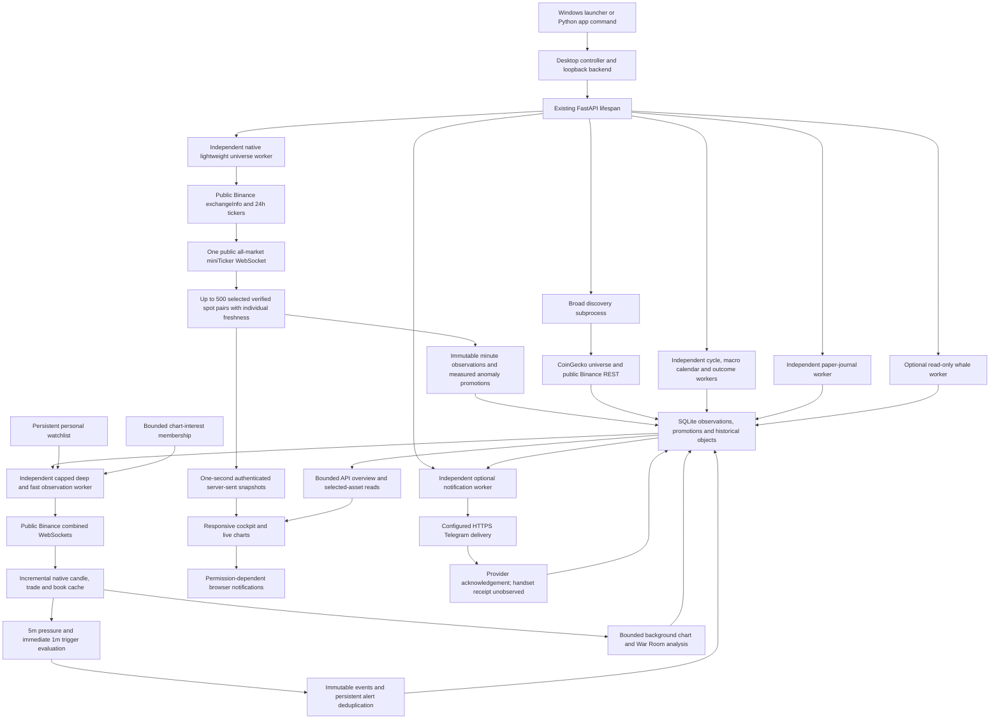

# Expansion Hunter — executable product architecture

Source audit: **6 October 2026 UTC**. This describes the current repository, not the functionality requested in earlier prompts. Existing status documents contain superseded sections; their historical test counts and absence claims must not be treated as the current source map.

The application is an **observation and decision-support system**. Public market observations produce measurable states, conditional paths and alerts. It has no private exchange client, order execution or withdrawals. Rule scores, pattern names, similarity and cycle labels are not calibrated probabilities or evidence of profitability.

## Actual runtime



### Startup and ownership

- `desktop.py` prepares persistent application paths, checks single-instance ownership, creates a private session credential and starts `desktop_backend.py` without a console on Windows. The backend binds an OS-assigned loopback port, opens the existing database and records automatic observation intent. The native window receives its credential only for the owned origin. The user does not need to type a localhost address.
- `api.py:create_app()` reuses the existing API. Its lifespan constructs `IntelligenceStore`, starts independent native-universe, notification, journal, intelligence, macro-calendar and whale tasks, constructs `DiscoveryService` and restores explicitly requested observation intent. Shutdown cancels and drains owned work before closing connections.
- `universe_live.py:run_universe_worker()` starts the independent lightweight native worker when observation is requested. Two bounded public REST bootstrap requests verify instruments and select up to the configured 500 USDT spot pairs by native 24h quote volume; `providers/universe_stream.py` then consumes one `!miniTicker@arr` stream. This path does not require CoinGecko coverage or full histories/order books for all pairs.
- `app_discovery.py` preserves the **separate broad-discovery process** with restart/backoff and richer historical feature/rank calculations. `intelligence_api.py` starts and supervises the independent `LiveObservationWorker` from persisted historical-discovery promotions, native minute-anomaly promotions or optional personal monitoring. A complete broad scan is not required before evaluating an already monitored coin. Intensive candle/trade/book subscriptions retain their separate `LiveFeedSettings.max_symbols` budget; 500 lightweight pairs does not mean 500 deep subscriptions.
- `live_runtime.py` keeps separate bounded analysis and write work. Completed candles invoke the fast state machine; expensive chart/structure calculations run in an executor. A slow similarity query, macro fetch or full-market scan is not placed in the 1m trigger function.
- `intelligence_runtime.py` owns serialized background cycle/analogue/outcome work and an independent BLS calendar task. `journal_runtime.py` observes saved paper positions. `whale_runtime.py` owns a separate optional on-chain observer. `notification_runtime.py` drains the configured delivery outbox through its own bounded HTTP/SQLite worker. These workers are actually started by the application lifespan, not merely unused classes.

### Native lightweight universe contract

The native universe is **quote-liquidity selected exchange instruments**, not a claim to reproduce the top 500 crypto assets by market capitalization. Verified Binance USDT spot identity and native quotes can operate while CoinGecko metadata is restricted or unavailable; a missing market-cap mapping remains `UNAVAILABLE`. The existing market-cap discovery path is preserved separately, with its actual exclusions and provider restrictions visible.

`!miniTicker@arr` publishes changed instruments. The API emits `/api/live/universe/stream` snapshots every second, but an unchanged row retains its original exchange and receipt timestamps. Refreshing the table or receiving a message for another pair cannot make that row fresh. Default per-symbol native status is `LIVE` through three seconds, `DELAYED` through fifteen seconds, then `STALE`; native seed observations begin delayed. Counts report requested, verified, selected, live, delayed, stale and excluded instruments with reasons. This stream has no native sequence IDs, so it cannot promise sequence-gap detection for mini-ticker events.

The worker derives observed minute-price returns only after a bounded causal baseline exists. Its cross-sectional **activity rank** uses actual available price activity, quote liquidity, BTC-relative behavior and a labelled change-in-rolling-24h-volume proxy. Rolling 24h totals are not 1m candle volume, true RVOL, taker flow, CVD, a book or an Expansion Readiness probability. This lightweight rank remains distinct from the existing historical discovery/rank-migration engine.

Automatic native promotions require fresh source observations, sufficient quote liquidity, measured minute-price activity and a BTC-relative anomaly. Defaults expose a bounded five-candidate promotion budget and a three-minute membership TTL. Minute archive cycles persist these promotions; the fast worker validates their source timestamps, verified identity and expiry before assigning available intensive slots. Promotion grants monitoring, not an invented readiness score or immediate breakout. The real 5m/1m engine must still confirm native pressure and breaks independently.

## Capability classification

**WORKING** means a wired executable path with deterministic component verification. It does not establish exchange coverage, predictive value, Windows GUI compatibility or 24/7 endurance. **PARTIAL** means important coverage or validation remains absent. **MISSING** means no completed implementation or required genuine dataset was found. **BROKEN / NEEDS ATTENTION** identifies a recorded operational failure or acceptance check still needing resolution.

| Capability | Classification | Executable hook and practical limit |
|---|---|---|
| Legacy scanner, indicators, AVWAP and risk calculations | WORKING within regression scope | Existing `scanner.py`, `technical.py`, `avwap.py`, `rules.py`, `risk.py` and legacy scan routes remain present. |
| Native 500-target lightweight universe | WORKING executable path; PARTIAL measured coverage/endurance | `universe_live.py`, `providers/universe_stream.py`, app-owned task and authenticated SSE. Selects available verified USDT spot pairs by quote liquidity; actual selected/live/delayed/stale counts determine coverage. It is independent of CoinGecko and does not download full histories/books for all pairs. |
| Historical broad discovery and capped deep/Fast monitoring | WORKING infrastructure; PARTIAL provider coverage | Existing `discovery.py`, supervised subprocess and `config/discovery.json` remain intact. CoinGecko market-cap/identity coverage and historical data can be restricted. Historical and native automatic promotions share a separately capped intensive monitoring budget. |
| Objective LONG/SHORT cross-sectional discovery | WORKING hypothesis calculations | `discovery_ranking.py`, `ranking_mode=BOTH`, separate directional cohorts and explicit historical/cross-sectional metadata. No winner symbols receive a production exception. |
| Rank history, velocity/acceleration and automatic promotion | WORKING within observed overlap | Discovery observation/history tables and scheduler persist ranks and transitions; incomparable or insufficient rank cohorts remain unavailable. |
| Native minute-relative anomaly promotion | WORKING measured infrastructure; PARTIAL history coverage | Fresh observed minute-price returns and BTC-relative anomalies persist bounded LONG/SHORT monitoring promotions. Missing causal baselines produce no promotion. Native activity ranks are not substituted for historical rank-velocity observations. |
| Native streaming price, trades, bid/ask, depth and candles | WORKING in bounded public smoke; PARTIAL endurance | `providers/binance_ws.py`, `live_feed.py`, independent live worker. Reconnect, timestamps, stale detection and sequence checks are executable. There is no demonstrated uninterrupted 24/7 service or full reconstructed exchange-wide order book. |
| Native gap repair | WORKING bounded helper and runtime integration | `live_repair.py` repairs missing recent 1m/5m/15m bars using limited same-venue REST requests. Existing finalized candles win; historical repairs do not emit retrospective breakout alerts. |
| Immediate LONG and SHORT ignition lifecycle | WORKING deterministic paths | `fast.py` and `fast_models.py` support pressure, intraminute attempts, completed 1m confirmation, failures, sweeps, subsequent 5m acceptance and 15m structure. Supporting volume changes quality, not whether the close crossed the predefined level. |
| Stateful structure, sequences and multi-timeframe agreement | WORKING measurable hypotheses | `war_room.py` preserves confirmed pivots and observed state transitions; `live_runtime.py:_persist_structure()` stores immutable transitions and restart memory. Six timeframes are separate. Startup context does not invent earlier observed transitions. |
| Objective named geometric patterns and setup contracts | WORKING hypothesis layer | `pattern_engine.py` and `setup_library.py` are invoked by `analyze_war_room()`. Patterns include tops/bottoms, triangles, flags, pennants, wedges, channels, rounded structures, deviations and failures. Insufficient geometric evidence yields no forced label. |
| Swing phases, directional decisions and three next steps | WORKING conditional calculations | Per-timeframe `swing_phases` records ten descriptive phases, known-start measurements and explicit trigger/invalidation. Next steps are conditional structural states, not three forecast OHLC candles. Unknown targets remain unknown. |
| Expected path and scenario tree | WORKING conditional calculations | War Room paths use current available structure, native fast boundary and known liquidity levels. Primary, alternative and failure cases do not receive invented probabilities. |
| Exact liquidity map | WORKING within available scope | Native **top-20 snapshot** prices/quantities remain `OBSERVED_ORDER_BOOK`; confirmed structural levels are separate. Disappearing walls are not automatically called consumed; structural stop locations remain inferred. |
| VWAP, AVWAP and profiles | WORKING with quality restrictions | Existing anchors preserved. Session/weekly VWAP requires sufficient actual history. POC/VAH/VAL/HVN/LVN candle allocations remain `ESTIMATED`, not exchange trade-at-price truth. |
| Own-timeframe active AutoFib and Golden Pocket | WORKING descriptive geometry | `live_analysis.py:active_fibonacci_view()` is emitted by live analysis and published to the API. Default ON; independent 1m/5m/15m/1h/4h/1D anchors, LONG/SHORT orientation and explicit invalidation. Predictive value remains unvalidated. |
| Fibonacci placebo/holdout edge | MISSING genuine validation | Research flags explicitly say `NOT_YET_EVALUATED` / `HYPOTHESIS_NOT_VALIDATED`. A confluence score does not establish a useful trading edge. |
| Stored Energy, numeric Absorption, Trigger Sensitivity and Readiness | WORKING LONG deterministic hypotheses; PARTIAL directional coverage | Existing LONG deep formulas expose components and missingness. They are not naively mirrored for shorts. SHORT deep Stored Energy/Absorption/Trigger Sensitivity/Readiness/RS/VWAP formula values explicitly remain `UNAVAILABLE` pending independent definitions and validation. |
| Per-timeframe symmetric setup/entry quality | WORKING uncalibrated context | The new swing-quality decomposition is separate from legacy deep readiness/ranking. Bounded own-frame Fib context is explicitly a hypothesis; it does not repair missing SHORT deep scores or establish probability. |
| Relative BTC/ETH context and dependency | WORKING where aligned histories exist; PARTIAL baskets | `relative_context.py` computes available returns/correlation/beta with identity, source and availability guards. Sector/universe/TOTAL3 baskets without reliable synchronized history are unavailable. |
| Measured trading-session context | WORKING with PARTIAL coverage explicit | `session_analysis.py` + `live_session_view()` measure closed-candle session OHLCV, coverage and reactions using IANA DST boundaries. Complete 5m reference coverage can replace truncated 1m coverage. These are research windows in a 24/7 crypto market, not official exchange opening hours. |
| Persistent personal list and optional chart priority | WORKING | Personal membership survives restarts. It changes monitoring priority, not score. Broad discovery works without entering personal coins. |
| Live chart, mobile layout and compact decision UI | WORKING code and bounded browser tests; PARTIAL final acceptance | `static/cockpit.html` consumes actual API data, updates without reload, selects six timeframes and exposes layer toggles and stale states. Selected-frame Fib is default; advanced context is optional. Full latest-build browser/disconnect acceptance must use the final smoke artifact. |
| Persistent alert history/deduplication | WORKING | Fast events, signal contexts, dedupe keys and outbox are stored. Event, receipt, evaluation and alert timestamps are distinct. |
| Browser and optional Telegram notifications | WORKING delivery adapter/tests; PARTIAL actual external acceptance | Browser notifications need permission and an open supported tab. `notification_runtime.py` sends configured recent persisted fast events, records actual provider acknowledgement/latency, retries bounded failures and preserves restart deduplication. Without both Telegram credentials it is `UNAVAILABLE` and makes no HTTP request. Mock-transport tests do not establish real Telegram or handset receipt; background browser push is absent. |
| Trade/risk/target/portfolio calculators | WORKING arithmetic and API/UI paths | `trade_calculator.py`, `calculator_api.py`, cockpit calculator. LONG/SHORT, fees, risk sizing and target profit are explicit assumptions. Cross/isolated liquidation is `ESTIMATED`, never an exact connected exchange liquidation price. |
| Paper journal and result analytics | WORKING manual paper observation; PARTIAL fill/account simulation | `paper_journal.py`, journal API/UI and background worker persist user-defined positions and available subsequent market intervals. This is not a live broker, exchange fill simulator or proof of realized profitability. Empty/insufficient outcomes yield no fabricated winrate. |
| Event library, matured outcomes and miss/failure analytics | WORKING infrastructure; PARTIAL denominator | Independent learning worker records actual observations and calculates sufficiently matured outcomes, directional MFE/MAE and misses. Unobserved assets and gaps are not treated as successfully monitored non-events. |
| Market cycle/congruence and macro calendar | PARTIAL operational evidence | Cycle calculations and APIs are wired to archived observations. Authoritative BLS schedule retrieval is independent and bounded. Missing breadth/derivatives produces incomplete evidence. Consensus and numeric live releases are unavailable from this calendar source. |
| Initial macro release versus revision storage | WORKING point-in-time models/tests; PARTIAL actual feed | Macro objects keep original and revised vintages separate. A schema/test does not supply a reliable real-time consensus or actual release provider. |
| Historical analogues | WORKING matching infrastructure; PARTIAL genuine library | Availability-filtered vectors, normalization and matching are separate from later outcome attachment. Similarity is descriptive; an empty or small real archive is not a reliable analogue distribution. |
| Optional whale/on-chain context | PARTIAL configured service | App-owned `run_whale_worker()` and `/api/whales` are wired. Etherscan key, explicit wallet/contract identities and confirmations are required. Transfers are not executed exchange orders; unknown intent/notional remains unknown. Default unconfigured output is `UNAVAILABLE`, weight zero. |
| Chronological integrated replay | WORKING with supplied vintages | `war_room_replay.py` invokes actual fast, analysis, structure and relative modules using only visible data. No historic intraminute book/flow/macro state is invented. |
| SAND/BEAM/AIN/AKT genuine matched-control regressions | MISSING completed study | Generic replay/control infrastructure exists; no completed point-in-time event definition, historical vintage universe and matched failure/control study proves these cases. |
| Calibrated probabilities, profitable edge, automatic self-optimization | MISSING / intentionally not claimed | Stored outcomes can grow; no validated model or autonomous production weight update is deployed. Millions of synthetic stress events do not prove predictive accuracy. |
| Astrology/numerology production influence | ABSENT | No such variable influences production alerts. A completed controlled research study for these hypotheses is not present. |
| Windows standalone artifact | PARTIAL verification | A genuine AMD64 PE32+ GUI launcher with embedded runtime/payload has been cross-built and inspected. Executing/installing the final GUI on real Windows remains unverified. Latest source changes require the final rebuilt artifact. |
| Reliable unattended 24/7 operation | NEEDS ATTENTION / unproved | Reconnection, supervision and restart memory exist; endurance, sustained writer backlog/database growth, complete universe coverage and real Windows shutdown/start behavior require measured acceptance. |

## Fast confirmation contract

The completed 5m history determines a resistance/support zone before the subsequent break. Defaults are explicit `FastSettings` hypotheses: 36-bar boundary lookback, confirmed pivots with two bars on each side, ATR14, 0.15 ATR zone tolerance, proximity within 0.75 ATR, pressure score at least 60 and at least two tests. The confirmation buffer is the larger of **0.05 ATR** and the configured exchange tick buffer. Unavailable tick evidence is disclosed.

LONG: live crossing is an attempt; a completed available 1m close above the predefined buffered resistance is confirmation. SHORT: a completed available 1m close below the predefined buffered support is confirmation. A wick crossing and close returning inside is a sweep/failed attempt, not confirmation. Quality evidence is evaluated afterward. Completed 5m/15m acceptance updates the lifecycle without delaying the earlier 1m alert. Stale, duplicate, out-of-order or unavailable critical observations cannot create a new high-priority confirmation.

## Active Fibonacci contract

The full backwards-compatible `fibonacci` research payload remains intact. `active_fibonacci` is a separate mapping keyed by the chart's own timeframe:

```text
1m / 5m / 15m / 1h / 4h / 1D
    enabled, status, quality, bias, swing_bias, direction
    pair_id, anchors, discovered_at
    source, source_timestamp, received_timestamp, evaluated_at, age_seconds
    retracements, extensions, levels, golden_pocket
    context, scores, confidence_quality, issues, reason
```

The selected pair is the most recent qualified opposite **confirmed pivots on that timeframe**. Default strict left/right confirmation is three bars; the discovery-time impulse must meet the configured ATR excursion. Each anchor records both its candle/event timestamp and when confirmation became available. A current unconfirmed high/low cannot replace a confirmed anchor. Each chart receives its own map; a 4h swing is not copied to every chart.

- LONG is low → high; SHORT is high → low.
- Active retracements: 0.382, 0.500, 0.618, 0.650, 0.705, 0.786. Active extensions: 1.272, 1.414, 1.618. Golden Pocket: configurable, default 0.618–0.650.
- The full research payload also preserves 0.236 and longer extensions. 0.500/0.650/0.705 and √2-related conventions retain their convention labels.
- Insufficient, mixed, gapped or noncausal anchor evidence yields `INSUFFICIENT_DATA`. Own-frame completed history older than 1.5 frame intervals yields `STALE` with no active overlay levels.
- Closing beyond the confirmed origin yields `INVALIDATED` / `ORIGIN_LOST`; active bias becomes unavailable and `swing_bias` preserves the historical orientation. It does not redraw an attractive older swing to hide the failure.
- `confidence_quality` describes confirmed geometry, contains `probability: null`, and labels predictive value unvalidated. Full Fibonacci research retains `production_weight: 0`; any bounded new contextual score component is an explicit uncalibrated hypothesis, separate from legacy ranking weights.

## Storage and market memory

The default operational database is **`data/cockpit.sqlite3`**. Desktop mode uses the prepared persistent user-data path, not a read-only installation directory. The API reports its database path. Legacy `smoke.sqlite3` evidence is not silently deleted or selected as a second operational database.

`IntelligenceStore` extends existing `DiscoveryStore` and legacy `Store`. Additive migrations retain the legacy scan tables and add discovery cycles/summaries/observations, snapshot objects/references, transitions/events and scheduling state. Intelligence tables hold immutable typed objects, signal contexts, current runtime state, personal watchlist and notification outbox. Paper-journal migrations add positions and immutable journal events. WAL, indexes and bounded projections support independent readers; worker connections are owned and drained before shutdown.

`runtime_states` is a **current operational cache**, not historical proof. Point-in-time research uses immutable objects/observations and their availability timestamps. Structure history is appended as it is observed. Restart restores prior state but freshness still requires new market evidence. Raw ticks are aggregated/bounded; chart reads do not repeatedly transfer every unrelated candle archive. These safeguards reduce load, but retained historical databases and large research runs still need a measured growth/retention budget.

The native worker appends compressed immutable `universe_live_observation` objects at the configured minute cadence, retaining actual row prices, feature/rank values, per-symbol exchange/receipt timestamps, freshness and coverage. `decode_universe_archive()` is a bounded historical reader; the mutable current universe refuses past-time queries rather than presenting today's membership as historical evidence. Archives only reconstruct their recorded resolution, not unrecorded intraminute ticks. `universe_promotion` and worker health are current operational projections alongside that archive.

Notification outbox migration is additive. Attempt, retry, terminal failure and acknowledged-delivery timestamps are retained, with stale backlog suppressed and already acknowledged events not replayed after an ordinary restart. A crash after Telegram accepts a request but before the local commit can cause an at-least-once retry duplicate; no exactly-once handset-delivery claim is made.

## API and UI interfaces

| Interface | Purpose |
|---|---|
| `/cockpit`, `/` | Existing responsive browser cockpit; desktop embeds the same application. |
| `/health`, `/ready`, `/api/live/health`, `/api/discovery/health` | Process, database, feed, worker, scanner and freshness evidence; process alive is not feed ready. |
| `/api/cockpit/overview` | Bounded discovery/fast summary for the main table. |
| `/api/live/universe`, `/api/live/universe/stream` | Native lightweight universe with actual per-symbol freshness and exclusions; authenticated SSE emits snapshots every second. Browser reconnection/polling fallback does not fabricate new exchange observations. |
| `/api/live/assets/{symbol}` | Selected coin's native candles, price, fast state, indicators, liquidity, AutoFib, measured sessions, War Room and relative context. |
| `/api/live/chart-interest/{symbol}` | Bounded priority interest for the selected chart; no artificial bullish score. |
| `/api/discovery/latest`, `/api/discovery/lists`, asset history/event routes | Ranked broad-cycle evidence, lists, point-in-time observations and transitions. |
| `/api/watchlist` | Persistent optional monitoring list with add/remove/pin/priority/notes. |
| `/api/live/alerts` | Real persisted lifecycle/provider/stale alerts. |
| `/api/intelligence/cycle`, macro calendar/context/event routes | Available cycle evidence and macro vintage/context archive. |
| `/api/intelligence/analogs/{asset_id}`, `/api/intelligence/events` | Historical research matching, outcomes and recorded misses. |
| `/api/whales` | Optional read-only on-chain observations, explicit source/configuration availability. |
| Calculator and journal routes | Manual decision-support arithmetic, paper position records and observed result analytics. |

The cockpit defaults to a compact Rookie view; Pro exposes additional research detail. Its universe list receives the independent native stream, while an opened or promoted coin receives intensive data only within the fast-watch budget. The selected timeframe controls its own chart, AutoFib and conditional swing steps. English/Dutch catalogs translate states without generating market claims. Browser notifications and optional server-side Telegram delivery have separate health; neither is proof of phone delivery merely because an alert exists in SQLite.

## Data honesty and replay boundaries

The critical guard is **`event_time <= decision_time` and `available_at <= decision_time`**. Candles must be completed, duration-correct and coherent. Strict swing discovery includes later confirmation bars only when those bars have become available. Macro initial releases and revisions have distinct received vintages. Outcome labels are read only after their horizon matures and matching has selected historical candidates.

Integrated replay cuts every input at each chronological boundary and carries forward the observed structure state. Historical candles downloaded today remain invisible before their actual recorded receipt unless a trustworthy historical availability lineage is supplied. It strips undated present-day ranking/metadata, preserves source identity and refuses invented historical regime, order book, CVD or intraminute events. This is a deterministic state/alert replay, not a validated trading-performance simulation.

Unavailable derivatives do not become neutral zeros. The current native public futures provider has known host restrictions; reliable liquidation clusters, native futures CVD, broad positioning, complete sector baskets, historical consensus vintages and survivorship-safe delisted universes are not comprehensively connected.

## Verification and remaining acceptance

Executable tests cover active Fib/session geometry, relative context, directional discovery, native array decoding, universe bootstrap/freshness, minute archives/promotions, SSE serialization, and Telegram acknowledgement/retry/restart behavior. Runtime tests exercise published native candles/levels, independent fast evaluation, restoration and chart-cache preservation. These deterministic tests are separate from genuine public-feed/browser checks and configured external notification delivery.

`reports/real-500-discovery.json` is an earlier **historical REST/CoinGecko discovery** check with degraded coverage. It does not measure the new independent native mini-ticker worker, and neither result may be presented as 500 simultaneously complete histories/order books. The latest genuine native-universe artifact must report selected instruments and actual per-symbol live/delayed/stale observations separately. Earlier genuine public WebSocket/browser artifacts remain bounded checks, not an all-feature endurance verdict.

Historical baseline failures and superseded test totals are retained in their original report files. Current repository-wide results, genuine public-data/browser smoke, final archive hash and Windows rebuild must be taken from the final delivery artifacts; this architecture document does not invent their counts or claim an unperformed external notification. No static type checker is configured in `pyproject.toml`; successful compilation/Ruff is not a substitute for claiming a type-check result.

The standalone launcher evidence in `reports/windows-launcher-build.json` explicitly states `windows_execution_tested: false`. A real PE executable and embedded payload are present, but Windows GUI/install behavior and the newest source bundle must be independently verified.

Before any profitable-edge, calibrated-probability or 24/7 claim: finish the final acceptance checks, collect genuine independent winner/non-winner cohorts, measure coverage and alert denominators, mature actual outcomes, run purged walk-forward and untouched holdout tests, account for execution costs, and measure sustained feed/write/UI load. The implemented workers do **not** automatically change trading rules or factor weights after a miss.
